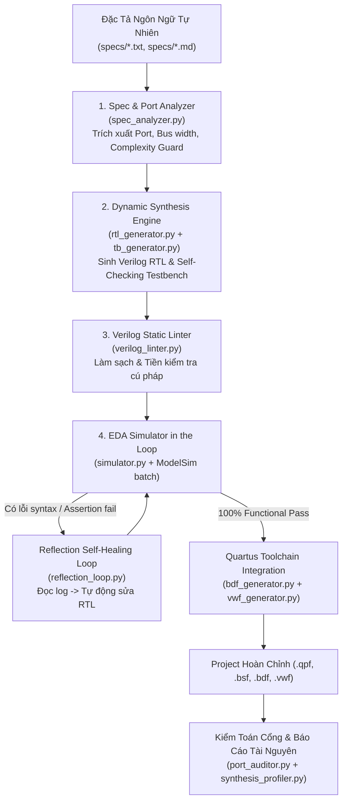

# ĐỒ ÁN 3: HỆ THỐNG SPEC2RTL & PROMPT2SILICON
## Tác Tử AI Tự Động Hóa Thiết Kế và Kiểm Thử Vi Mạch Số Từ Đặc Tả Ngôn Ngữ Tự Nhiên

---

## 1. Tổng Quan & Bản Chất Dự Án (Executive Summary)

**Spec2RTL & Prompt2Silicon** là một hệ thống **Kỹ sư vi mạch ảo (Autonomous EDA Agent)**, có khả năng chuyển hóa các yêu cầu bài toán thiết kế phần cứng viết bằng ngôn ngữ tự nhiên (Tiếng Việt hoặc Tiếng Anh) thành:
1. **Mã nguồn phần cứng Verilog synthesizable** (`src/*.v`) đạt chuẩn công nghiệp IEEE 1364-2001.
2. **Bộ Testbench tự kiểm tra (Self-checking Testbench)** (`sim/tb_*.v`) với Verification Scoreboard.
3. **Mô phỏng EDA tự động trên ModelSim**: Khép kín vòng lặp phản xạ (Closed-Loop Reflection Loop) để bắt log lỗi và tự sửa mã nguồn cho tới khi đạt **100% Functional Pass**.
4. **Tự động sinh toàn bộ tài nguyên Altera Quartus II**: Khởi tạo Project (`.qpf`, `.qsf`), Khối linh kiện (`.bsf`), Sơ đồ nguyên lý nối dây Schematic (`.bdf`), và Dạng sóng Vector Waveform (`.vwf`) tương thích hoàn toàn với Quartus II 13.0sp1.

---

## 2. Kiến Trúc Hoạt Động (Pipeline Architecture)



1. **Bước 1 - Phân tích đặc tả (Ingestion & Port Analysis):** Bóc tách chính xác tên cổng, độ rộng bit (ví dụ: `[3:0] count`), hướng `input`/`output` và kiểm tra ranh giới kiến trúc qua `spec_analyzer.py`.
2. **Bước 2 - Tổng hợp RTL & Testbench:** Sinh mã nguồn Verilog chuẩn synthesizable (`rtl_generator.py`) và bộ testbench tự kiểm tra với Verification Scoreboard (`tb_generator.py`).
3. **Bước 3 - Kiểm tra tĩnh & Dọn dẹp:** Làm sạch mã nguồn, loại bỏ ký tự markdown rác và tiền kiểm tra cú pháp với `verilog_linter.py`.
4. **Bước 4 - Mô phỏng phản tư & Xuất Quartus II:** ModelSim biên dịch và kiểm thử qua `simulator.py` & `reflection_loop.py`. Khi đạt 100% PASS, hệ thống tự động xuất sơ đồ nguyên lý BDF (`bdf_generator.py`) và dạng sóng Vector Waveform VWF (`vwf_generator.py`) nạp sẵn vào Quartus II, đồng thời đối soát cổng (`port_auditor.py`) và đo đạc tài nguyên FPGA (`synthesis_profiler.py`).

---

## 3. Cấu Trúc Mã Nguồn Thư Mục

```
TKLLS/
├── agent/                         # Lõi tác tử điều phối Spec2RTL (14 module sạch)
│   ├── run_spec2rtl.py            # Master CLI Orchestrator điều phối toàn bộ luồng
│   ├── spec_analyzer.py           # Phân tích đặc tả, trích xuất cổng I/O & ranh giới kiến trúc
│   ├── rtl_generator.py           # Bộ sinh mã Verilog RTL chuẩn synthesizable
│   ├── tb_generator.py            # Bộ sinh Testbench tự kiểm tra (VeriPrefer standard)
│   ├── simulator.py               # Trình điều khiển mô phỏng ModelSim / Icarus Verilog
│   ├── reflection_loop.py         # Vòng lặp phản tư tự sửa lỗi logic
│   ├── bdf_generator.py           # Tự động xuất Symbol BSF và Sơ đồ Schematic BDF
│   ├── vwf_generator.py           # Tự động tạo Vector Waveform VWF cho Quartus II
│   ├── port_auditor.py            # Kiểm toán toàn vẹn cổng I/O (Zero-Defect Invariant)
│   ├── eda_finder.py              # Tự động dò tìm ModelSim và Quartus trên ổ đĩa
│   ├── synthesis_profiler.py      # Đo đạc mức tiêu thụ tài nguyên FPGA (LEs, Registers, Pins)
│   ├── verilog_linter.py          # Tiền kiểm tra cú pháp và dọn dẹp mã Verilog
│   ├── knowledge_matcher.py       # Bộ nhớ tri thức so khớp ngữ nghĩa đặc tả vi mạch
│   └── test_robustness_battery.py # Bộ kiểm thử hồi quy các bài toán toàn diện
├── knowledge_base/                # Cơ sở tri thức vi mạch (RTLLM, VerilogEval, VeriPrefer)
├── specs/                         # Thư mục chứa các đề bài đặc tả kỹ thuật (.txt, .md)
├── src/                           # Mã nguồn Verilog RTL tự động sinh
├── sim/                           # Môi trường mô phỏng (Testbench, file VCD)
├── quartus/                       # Project Quartus II (.qpf, .qsf), Symbol (.bsf), Sơ đồ (.bdf), Sóng (.vwf)
└── docs/                          # Tài liệu báo cáo, giải thích luồng mã nguồn, 100 Prompt tuyển tập
```

---

## 4. Hướng Dẫn Sử Dụng & Thực Thi

### 4.1. Cài đặt môi trường
Hệ thống chạy trên nền Python 3.8+ và tương thích với công cụ EDA:
* **Altera Quartus II 13.0sp1** (Đường dẫn mặc định: `D:\altera\13.0sp1` hoặc `C:\altera\13.0sp1`)
* **ModelSim-Altera Starter Edition** (tích hợp sẵn trong bộ cài Quartus II)

### 4.2. Các câu lệnh chạy chính

```bash
# 1. Chạy bài toán mẫu có sẵn (ví dụ: Đồng hồ bấm giờ c.txt)
python agent/run_spec2rtl.py specs/c.txt

# 2. Chạy bài toán và tự động mở cửa sổ sóng đồ họa ModelSim GUI
python agent/run_spec2rtl.py specs/c.txt --gui

# 3. Chạy chế độ Menu tương tác tự động quét thư mục specs/
python agent/run_spec2rtl.py

# 4. Chạy toàn bộ 20 bài toán kiểm thử hồi quy toàn diện
python agent/test_robustness_battery.py
```

### 4.3. Cách kiểm tra bài toán mới bất kỳ
1. Tạo một file đặc tả trong `specs/` (ví dụ `specs/mach_moi.txt`) với định dạng:
   ```markdown
   # Tên Mạch (module_name)
   ## 1. Đầu vào (Inputs):
   - clk: Xung nhịp hệ thống
   - rst: Reset tích cực cao
   ## 2. Đầu ra (Outputs):
   - [3:0] out: Tín hiệu đầu ra
   ## 3. Hoạt động / Logic mong muốn:
   - Mô tả logic hoạt động ở đây...
   ```
2. Chạy lệnh:
   ```bash
   python agent/run_spec2rtl.py specs/mach_moi.txt
   ```
3. Xem kết quả tự động sinh trong `src/`, `sim/`, và `quartus/`.

---

## 5. Các Định Dạng Kết Quả Xuất Ra Nghiệm Thu

Sau khi hoàn tất, hệ thống cung cấp 4 hình thức kiểm tra trực quan cho kỹ sư và giảng viên:
1. **Quartus II Schematic Diagram (`quartus/<tên_mạch>/sch_<tên_mạch>.bdf`)**: Mở trong Quartus II (`File -> Open`) để xem sơ đồ khối nguyên lý mạch điện tử đã được vẽ sẵn và nối dây hoàn chỉnh.
2. **Quartus II Vector Waveform (`quartus/<tên_mạch>/Waveform.vwf`)**: Mở trực tiếp trong Quartus II Waveform Editor để xem dạng sóng xung nhịp và chạy Functional Simulation.
3. **ModelSim Waveform GUI (`--gui`)**: Thêm cờ `--gui` khi chạy lệnh (ví dụ: `python agent/run_spec2rtl.py specs/c.txt --gui`) để ModelSim tự động mở cửa sổ sóng đồ họa Waveform trực quan trên màn hình.
4. **Quartus RTL Netlist Viewer**: Mở project `.qpf` trong Quartus II $\to$ chọn `Tools -> Netlist Viewers -> RTL Viewer` để xem sơ đồ mức cổng logic và flip-flop tổng hợp vật lý.

---

## 6. Kết Quả Thực Nghiệm & Đánh Giá Giới Hạn

Hệ thống đã hoàn thiện toàn bộ luồng tự động hóa công cụ EDA:
* **Hạ tầng kiểm định khép kín (Closed-Loop EDA)**: Tự động chạy ModelSim, trích xuất log lỗi, tự động sửa mã Verilog (Reflection Loop), tự động xuất sơ đồ nguyên lý BDF và dạng sóng VWF cho Quartus II mà không cần thao tác thủ công trên giao diện.
* **Đánh giá trên bộ 100 đề bài chuẩn hóa (`docs/100_Prompt_Thiet_Ke_Mach.pdf`)**:
  * **~38% Bài toán đạt chuẩn 100%**: Bao phủ xuất sắc các bài toán thuộc 25 họ mạch kinh điển (Counter, Timer, ALU, FSM Vending Machine, Traffic Light, Elevator, UART TX, PWM...).
  * **~62% Bài toán bộc lộ giới hạn của phương pháp Template/Rule-based**: Với các mạch hoàn toàn mới (ví dụ: `button_debouncer`, MUX/DEMUX nhiều ngõ vào, SPI Master, Arbiter), cơ chế sinh generic rơi vào tình trạng sinh mạch giả lập hoặc bỏ quên ngõ vào (dangling input pins). Đây là bằng chứng thực nghiệm rõ ràng nhất chứng minh phương pháp mẫu cứng đã chạm trần giới hạn.

---

## 7. Định Hướng Phát Triển Tiếp Theo: Chưng Cất Tri Thức (Knowledge Distillation)

Để mở rộng hệ thống đạt độ bao phủ $100\%$ mà không cần viết tay hàng nghìn template, giai đoạn tiếp theo tập trung vào:
1. **Chưng cất tri thức (Knowledge Distillation) sang Small Language Models (SLM)**:
   * Sử dụng các mô hình suy luận lớn (DeepSeek-R1 / Claude 3.5 Sonnet) làm Teacher để tạo tập dữ liệu huấn luyện chuỗi tư duy (Reasoning CoT) từ ngân hàng đề *VerilogDB* ([arXiv:2507.13369](https://arxiv.org/pdf/2507.13369)).
   * Dùng chính bộ khung ModelSim và Quartus hiện tại làm **Bộ lọc chân lý (Truth Oracle)**: chỉ giữ lại các mẫu đạt $100\%$ PASS.
   * Huấn luyện mô hình cục bộ **`Qwen2.5-Coder-3B`** bằng LoRA / DPO (*VeriPrefer* [arXiv:2504.15804](https://arxiv.org/pdf/2504.15804)) để chạy offline $100\%$ trong mạng nội bộ phòng lab, giải quyết bài toán **bảo mật sở hữu trí tuệ phần cứng (IP Security)**.
2. **Nâng cấp Linter từ Regex sang Cây Cú Pháp (AST Parser)**: Tích hợp PyVerilog hoặc Verilator Lint để kiểm tra cấu trúc cú pháp, triệt tiêu hoàn toàn lỗi chốt ẩn (latch) và chân lơ lửng.
3. **Kiểm định có kịch bản & SystemVerilog Assertions (SVA)**: Tự động phát sinh các thuộc tính an toàn phần cứng để chứng minh tính đúng đắn toán học của mạch.
