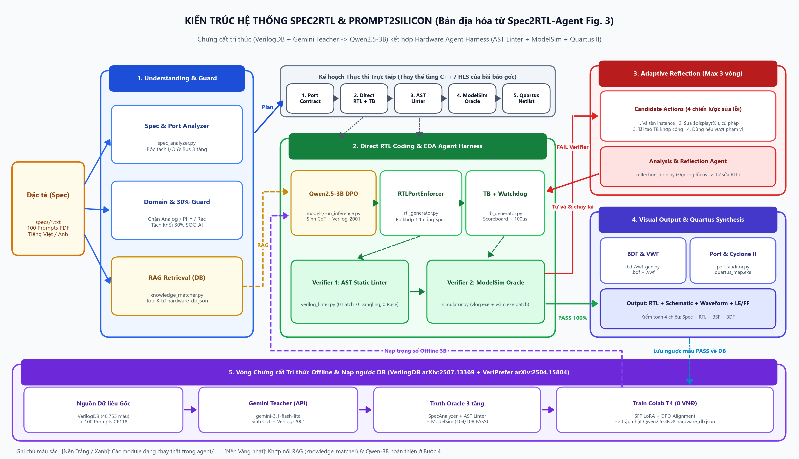

# ĐỒ ÁN 3: HỆ THỐNG SPEC2RTL & PROMPT2SILICON
## Tác Tử AI Tự Động Hóa Thiết Kế và Kiểm Thử Vi Mạch Số Từ Đặc Tả Ngôn Ngữ Tự Nhiên

---

## 1. Tổng Quan & Bản Chất Dự Án (Executive Summary)

**Spec2RTL & Prompt2Silicon** là một hệ thống **Kỹ sư vi mạch ảo (Autonomous EDA Agent)**, có khả năng chuyển hóa các yêu cầu bài toán thiết kế phần cứng viết bằng ngôn ngữ tự nhiên (Tiếng Việt hoặc Tiếng Anh) thành:
1. **Mã nguồn phần cứng Verilog synthesizable** (`src/*.v`) đạt chuẩn công nghiệp IEEE 1364-2001.
2. **Bộ Testbench tự kiểm tra (Self-checking Testbench)** (`sim/tb_*.v`) với Verification Scoreboard.
3. **Mô phỏng EDA tự động trên ModelSim**: Khép kín vòng lặp phản xạ (Closed-Loop Reflection Loop) để bắt log lỗi và tự sửa mã nguồn cho tới khi đạt **100% Functional Pass**.
4. **Tự động sinh toàn bộ tài nguyên Altera Quartus II**: Khởi tạo Project (`.qpf`, `.qsf`), Khối linh kiện (`.bsf`), Sơ đồ nguyên lý nối dây Schematic (`.bdf`), và Dạng sóng Vector Waveform (`.vwf`) tương thích hoàn toàn với Quartus II 13.0sp1.

---

## 2. Kiến Trúc Hoạt Động (Spec2RTL-Agent Fig. 3 Adapted)



> *Sơ đồ bản địa hóa trực tiếp theo cấu trúc **Fig. 3** của bài báo **Spec2RTL-Agent** (`arXiv:2506.13905`), tích hợp thêm **Hybrid Vector RAG**, **cầu nối AI chưng cất `--use-distilled`**, **Dual Verifier (AST Linter + ModelSim)** và **vòng nạp ngược tri thức `save_verified_design()`**.*

1. **Pha 1 — Iterative Understanding & Planning (`spec_analyzer.py`, `knowledge_matcher.py`):**
   * Chạy chuỗi 4 bước kiểm chéo: **Spec & Port Analyzer** (bóc tách cổng I/O & bus 3 tầng) $\to$ **Domain & 30% Guard** (`check_unsupported_domain()`, `is_30_percent_architecture()`) $\to$ **Hybrid RAG Retrieval** (`Vector + BM25 + 3-gram RRF` trên `643` mẫu từ `hardware_db.json` + `dataset_teacher_distilled.json`) $\leftrightarrow$ **Port & Plan Verifier** để chốt `Implementation Plan` (`Port Contract`, `RAG Top-K Context`, `RTL Gen Strategy`, `Self-Check TB Spec`).
2. **Pha 2 — Direct RTL Coding (`models/run_inference.py`, `rtl_generator.py`, `tb_generator.py`):**
   * Sinh Verilog trực tiếp qua mô hình **`Qwen2.5-3B DPO`** (`--use-distilled`, có `use_rag=True`) hoặc fallback an toàn về `RTLGenerator` $\to$ ép khớp chân 1:1 qua **`RTLPortEnforcer`** $\to$ sinh **Self-Checking Testbench** (có Verification Scoreboard tự chấm `[SUCCESS]`/`[FAIL]` cho các họ mạch 70%).
3. **Pha 3 — Dual-Verifier & Adaptive Reflection (`verilog_linter.py`, `simulator.py`, `reflection_loop.py`):**
   * Kiểm chứng 2 tầng **Verifier 1 (AST Static Linter thuần Python: 0 Latch, 0 Dangling, 0 Race)** $\to$ **Verifier 2 (ModelSim Oracle)**. Nếu **FAIL**, `Analysis Agent` (`diagnose_error()`) $\to$ `Reflection Agent` (`apply_auto_repair()`) chọn trong **Candidate Actions** (tối đa 3 vòng) để tự vá RTL/TB và chạy lại.
4. **Pha 4 — EDA Synthesis, Visual Output & Closed-Loop DB (`bdf_generator.py`, `vwf_generator.py`, `port_auditor.py`, `synthesis_profiler.py`):**
   * Khi **100% PASS**, xuất Project Quartus II (`.qpf`, `.qsf`), Symbol (`.bsf`), Schematic (`.bdf`), Waveform (`.vwf`), kiểm toán 4 chiều ($\text{Spec} \equiv \text{RTL} \equiv \text{BSF} \equiv \text{BDF}$) và đo tài nguyên Cyclone II (`LEs`, `FFs`); đồng thời gọi **`save_verified_design()`** nạp ngược mẫu đạt chuẩn (chống trùng MD5) về `knowledge_base/hardware_db.json`.
5. **Pha 5 — Offline Knowledge Distillation (`training/distill_teacher_cot.py`, Google Colab):**
   * Chưng cất từ **VerilogDB** + **100 Prompts CE118** qua **Gemini Teacher (`gemini-3.1-flash-lite`)** & Truth Oracle 3 tầng (đạt `104/108` mẫu CoT sạch đợt 1) để huấn luyện **SFT LoRA + DPO** cho `Qwen2.5-Coder-3B` trên Colab T4, rồi nạp trọng số GGUF/LoRA về `models/`.

---

## 3. Cấu Trúc Mã Nguồn Thư Mục

```
TKLLS/
├── agent/                         # Lõi tác tử Spec2RTL (13 module lõi & 2 bộ kiểm thử)
│   ├── run_spec2rtl.py            # Master CLI Orchestrator (--use-distilled, closed-loop DB)
│   ├── spec_analyzer.py           # Domain Guard (30%/70%) & bóc tách cổng I/O 3 tầng
│   ├── rtl_generator.py           # RTLPortEnforcer & bộ sinh RTL fallback synthesizable
│   ├── tb_generator.py            # Self-Checking Testbench cho các họ mạch 70%
│   ├── simulator.py               # Trình điều khiển mô phỏng ModelSim / Icarus Verilog
│   ├── reflection_loop.py         # Vòng lặp phản tư tự sửa lỗi logic (max 3 vòng)
│   ├── bdf_generator.py           # Tự động xuất Symbol BSF và Sơ đồ Schematic BDF
│   ├── vwf_generator.py           # Tự động tạo Vector Waveform VWF cho Quartus II
│   ├── port_auditor.py            # Kiểm toán toàn vẹn cổng I/O 4 chiều
│   ├── eda_finder.py              # Tự động dò tìm ModelSim và Quartus trên ổ đĩa
│   ├── synthesis_profiler.py      # Đo đạc mức tiêu thụ tài nguyên FPGA (LEs, Registers, Pins)
│   ├── verilog_linter.py          # Bộ phân tích tĩnh AST thuần Python (0 Latch/Dangling/Race)
│   ├── knowledge_matcher.py       # Hybrid RAG (Vector + BM25 + 3-gram RRF) & save_verified_design()
│   ├── test_group3_linter.py      # Kiểm thử AST Linter & Domain Guard (5/5)
│   └── test_robustness_battery.py # Bộ kiểm thử hồi quy 20 bài toán toàn diện (20/20)
├── models/                        # Suy luận AI cục bộ (run_inference.py: GGUF / PyTorch + RAG)
├── training/                      # Chưng cất Gemini Teacher CoT, dataset SFT/DPO & Colab 3B
├── benchmarks/                    # Benchmark toàn trình & bộ 28 truy vấn RAG nhóm 70%
├── reports/                       # Báo cáo thực nghiệm Linter, Tuần 2 & Benchmark RAG 70%
├── knowledge_base/                # Cơ sở tri thức vi mạch (hardware_db.json, reflection_db.json)
├── specs/                         # Thư mục chứa các đề bài đặc tả kỹ thuật (.txt, .md)
├── docs/                          # Slide HTML bảo vệ, kịch bản thuyết trình, sơ đồ kiến trúc, 100 Prompts
└── HANDOFF_NEXT_STEPS.md          # Hướng dẫn bàn giao chi tiết khi chuyển sang máy mới
```

---

## 4. Hướng Dẫn Sử Dụng & Thực Thi

### 4.1. Cài đặt môi trường
Hệ thống chạy trên nền Python 3.8+ và tương thích với công cụ EDA:
* **Altera Quartus II 13.0sp1** (Đường dẫn mặc định: `D:\altera\13.0sp1` hoặc `C:\altera\13.0sp1`)
* **ModelSim-Altera Starter Edition** (tích hợp sẵn trong bộ cài Quartus II)

### 4.2. Các câu lệnh chạy chính

```bash
# 1. Chạy bài toán mẫu có sẵn (ví dụ: Đồng hồ bấm giờ c.txt)
python agent/run_spec2rtl.py specs/c.txt

# 2. Chạy kèm AI chưng cất (Qwen2.5-3B + Hybrid Vector RAG, tự fallback RTLGenerator)
python agent/run_spec2rtl.py specs/c.txt --use-distilled

# 3. Chạy bài toán và tự động mở cửa sổ sóng đồ họa ModelSim GUI
python agent/run_spec2rtl.py specs/c.txt --gui

# 4. Chạy bộ kiểm thử AST Linter, 20 bài robustness và Benchmark RAG 70%
python agent/test_group3_linter.py
python agent/test_robustness_battery.py
python benchmarks/benchmark_70_rag.py
```

### 4.3. Cách kiểm tra bài toán mới bất kỳ
1. Tạo một file đặc tả trong `specs/` (ví dụ `specs/mach_moi.txt`) với định dạng:
   ```markdown
   # Tên Mạch (module_name)
   ## 1. Đầu vào (Inputs):
   - clk: Xung nhịp hệ thống
   - rst: Reset tích cực cao
   ## 2. Đầu ra (Outputs):
   - [3:0] out: Tín hiệu đầu ra
   ## 3. Hoạt động / Logic mong muốn:
   - Mô tả logic hoạt động ở đây...
   ```
2. Chạy lệnh:
   ```bash
   python agent/run_spec2rtl.py specs/mach_moi.txt
   ```
3. Xem kết quả tự động sinh trong `src/`, `sim/`, và `quartus/`.

---

## 5. Các Định Dạng Kết Quả Xuất Ra Nghiệm Thu

Sau khi hoàn tất, hệ thống cung cấp 4 hình thức kiểm tra trực quan cho kỹ sư và giảng viên:
1. **Quartus II Schematic Diagram (`quartus/<tên_mạch>/sch_<tên_mạch>.bdf`)**: Mở trong Quartus II (`File -> Open`) để xem sơ đồ khối nguyên lý mạch điện tử đã được vẽ sẵn và nối dây hoàn chỉnh.
2. **Quartus II Vector Waveform (`quartus/<tên_mạch>/Waveform.vwf`)**: Mở trực tiếp trong Quartus II Waveform Editor để xem dạng sóng xung nhịp và chạy Functional Simulation.
3. **ModelSim Waveform GUI (`--gui`)**: Thêm cờ `--gui` khi chạy lệnh (ví dụ: `python agent/run_spec2rtl.py specs/c.txt --gui`) để ModelSim tự động mở cửa sổ sóng đồ họa Waveform trực quan trên màn hình.
4. **Quartus RTL Netlist Viewer**: Mở project `.qpf` trong Quartus II $\to$ chọn `Tools -> Netlist Viewers -> RTL Viewer` để xem sơ đồ mức cổng logic và flip-flop tổng hợp vật lý.

---

## 6. Kết Quả Thực Nghiệm & Đánh Giá Giới Hạn

Hệ thống đã hoàn thiện toàn bộ luồng tự động hóa công cụ EDA:
* **Hạ tầng kiểm định khép kín (Closed-Loop EDA)**: Tự động chạy ModelSim, trích xuất log lỗi, tự động sửa mã Verilog (Reflection Loop), tự động xuất sơ đồ nguyên lý BDF và dạng sóng VWF cho Quartus II mà không cần thao tác thủ công trên giao diện.
* **Đánh giá trên bộ 100 đề bài chuẩn hóa (`docs/100_Prompt_Thiet_Ke_Mach.pdf`)**:
  * **~38% Bài toán đạt chuẩn 100%**: Bao phủ xuất sắc các bài toán thuộc 25 họ mạch kinh điển (Counter, Timer, ALU, FSM Vending Machine, Traffic Light, Elevator, UART TX, PWM...).
  * **~62% Bài toán bộc lộ giới hạn của phương pháp Template/Rule-based**: Với các mạch hoàn toàn mới (ví dụ: `button_debouncer`, MUX/DEMUX nhiều ngõ vào, SPI Master, Arbiter), cơ chế sinh generic rơi vào tình trạng sinh mạch giả lập hoặc bỏ quên ngõ vào (dangling input pins). Đây là bằng chứng thực nghiệm rõ ràng nhất chứng minh phương pháp mẫu cứng đã chạm trần giới hạn.

---

## 7. Định Hướng Phát Triển Tiếp Theo: Chưng Cất Tri Thức (Knowledge Distillation) & Tinh Chỉnh Mô Hình (Fine-Tuning)

Để mở rộng hệ thống đạt độ bao phủ $100\%$ các bài toán vi mạch mà không cần viết tay hàng nghìn template, đồng thời triệt tiêu hoàn toàn lỗi chân lơ lửng (dangling pins) và chốt ẩn (inferred latches), nhóm triển khai **Kế hoạch 2 tuần với 6 thành viên (chia 3 nhóm song song, chi phí 0 VNĐ)**:

### 7.1. Ba Nhánh Triển Khai Song Song (Phân công 6 Thành viên)

1. **Nhóm 1: Chuẩn Bị Dữ Liệu & Thẩm Định Chân Lý (2 Thành viên)**
   * **Mục tiêu:** Xây dựng tập dữ liệu sạch gồm **1.000 mẫu vi mạch chuẩn hóa** từ *VerilogDB* ([arXiv:2507.13369](https://arxiv.org/pdf/2507.13369)) và ngân hàng 100 Prompt của đề tài.
   * **Cơ chế:** Dùng mô hình suy luận lớn (DeepSeek-R1 / Gemini) làm Teacher sinh chuỗi tư duy phần cứng (CoT: Phân tích I/O $\to$ FSM $\to$ Verilog synthesizable $\to$ Testbench).
   * **Bộ lọc chân lý (Truth Oracle):** Dùng chính `simulator.py` chạy ngầm ModelSim batch để thẩm định 100% mẫu; loại bỏ toàn bộ code lỗi cú pháp hoặc fail assertion.
   * **Định dạng bàn giao:** Đóng gói đúng cấu trúc 3 trường `(instruction, input, output)` tại [`training/dataset_clean_verified.json`](training/dataset_clean_verified.json).

2. **Nhóm 2: Huấn Luyện AI Cục Bộ & Fine-Tuning (2 Thành viên)**
   * **Mục tiêu:** Thực hiện **Chưng cất tri thức (Knowledge Distillation) thông qua kỹ thuật Fine-Tuning (Supervised Fine-Tuning - SFT với LoRA 4-bit)** để mô hình chạy offline $100\%$ bảo mật tuyệt đối tài sản trí tuệ (IP Security).
   * **Hạ tầng & Chi phí:** Dùng thư viện tối ưu **Unsloth** chạy trên **Google Colab GPU T4 miễn phí (0 VNĐ)**. Thời gian huấn luyện 1.000 mẫu chỉ mất **~15 đến 25 phút**.
   * **Notebook hoàn chỉnh:** Đã lập trình và kiểm thử thành công tại [`training/train_spec2rtl_qwen3b_colab.ipynb`](training/train_spec2rtl_qwen3b_colab.ipynb).
   * **Thực nghiệm đối sánh 2 phiên bản mô hình (Ablation Study):**
     * **Bản 1.5B (`Qwen2.5-Coder-1.5B`)**: Siêu nhẹ (~1GB RAM lượng tử hóa 4-bit), chạy trực tiếp trên CPU máy tính phòng lab trường hoặc nhúng lên kit FPGA/Raspberry Pi không cần card GPU rời.
     * **Bản 3B (`Qwen2.5-Coder-3B`)**: Tăng cường năng lực suy luận chuỗi dài (Reasoning) cho các khối vi kiến trúc phức tạp (FSM đa tầng, bộ điều khiển bus, FIFO).

3. **Nhóm 3: Kỹ Thuật Vi Mạch & AST Linter (2 Thành viên)**
   * **Mục tiêu:** Nâng cấp `agent/verilog_linter.py` từ Regex sang Cây cú pháp trừu tượng (**Abstract Syntax Tree - AST Parser**) sử dụng thư viện **PyVerilog**.
   * **Bộ phát hiện chân lơ lửng (Dangling Pin Detector):** Quét toàn bộ cây cú pháp trong khối `always`/`assign`, bắt chết lỗi cổng `input` bị cô lập (triệt tiêu dứt điểm ca lỗi như `button_debouncer`).
   * **Bộ triệt tiêu chốt ẩn (Inferred Latch Detector):** Duyệt các câu lệnh điều kiện `if/case` trong khối tổ hợp `always @(*)`, ép buộc phải có đầy đủ nhánh gán mặc định (`else` / `default`).
   * **Đo kiểm thực nghiệm:** Phối hợp đo đạc tỷ lệ Pass@1 trên toàn bộ 100 đề bài vi mạch và đo tài nguyên tiêu thụ trên chip Altera Cyclone II.

---

### 7.2. Lộ Trình 2 Tuần Về Đích (Roadmap)

| Thời Gian | Nhóm 1 (Dữ Liệu) | Nhóm 2 (Fine-Tuning AI) | Nhóm 3 (AST Linter & Vi Mạch) |
| :--- | :--- | :--- | :--- |
| **Tuần 1** | Lọc dữ liệu VerilogDB + ModelSim thẩm định ra 1.000 mẫu sạch. | Dựng xong Colab Unsloth LoRA & test dummy run thành công *(Đã xong)*. | Xây dựng bộ quét cây cú pháp PyVerilog AST bắt chốt ẩn & chân lơ lửng. |
| **Tuần 2** | Bàn giao file `dataset_1000_clean.json`. | Bấm nút Fine-Tune mô hình 1.5B & 3B trên Colab (15-20 phút), xuất GGUF. | Tích hợp model đã train vào `agent/run_spec2rtl.py`, chạy benchmark 100 bài toán. |
| **Nghiệm thu** | \multicolumn{3}{c|}{Tổng hợp số liệu thực nghiệm, hoàn thiện Slide báo cáo và file báo cáo đồ án nộp Thầy.} |

---

## 8. Cơ Sở Khoa Học & Nguồn Gốc Ý Tưởng Từ Các Tài Liệu Nghiên Cứu (Academic References & Provenance)

Hệ thống **Spec2RTL & Prompt2Silicon** được thiết kế và hiện thực hóa dựa trên việc kế thừa, tổng hợp và bản địa hóa các ý tưởng nghiên cứu đỉnh cao từ **6 tài liệu khoa học nền tảng do Giảng viên hướng dẫn (TS. Nguyễn Văn Tình) định hướng**:

| STT | Tài Liệu / Bài Báo | Tác Giả & Tổ Chức | Ý Tưởng Kế Thừa Cốt Lõi | Module Hiện Thực Trong Hệ Thống |
| :--- | :--- | :--- | :--- | :--- |
| 1 | **Spec2RTL-Agent**<br/>([arXiv:2506.13905](https://arxiv.org/abs/2506.13905)) | NVIDIA Research, Cadence, Georgia Tech | Kiến trúc đa tác tử 3 pha: Understanding $\to$ Coding $\to$ Reflection | `spec_analyzer.py`, `rtl_generator.py`, `reflection_loop.py` |
| 2 | **From RTL to Prompt Coding**<br/>([arXiv:2601.13815](https://arxiv.org/html/2601.13815v1)) | RPTU Kaiserslautern-Landau, Tiny Tapeout (ISCAS 2026) | Triết lý "Prompt Coding" - Đưa yêu cầu tự nhiên thẳng tới phần cứng | `specs/*.txt`, `100_Prompt_Thiet_Ke_Mach.pdf` |
| 3 | **Prompt2Silicon Platform**<br/>([GitHub tukl-msd](https://github.com/tukl-msd/prompt2silicon)) | Microelectronic Systems Design Group (RPTU) | Trực quan hóa toàn trình (Visual EDA Verification: Schematic & Waveform) | `bdf_generator.py`, `vwf_generator.py`, `--gui` |
| 4 | **Autonomous Chip Design Agents**<br/>([NVIDIA GTC 2025 S72294](https://www.nvidia.com/en-us/on-demand/session/gtc25-S72294/)) | NVIDIA Research (Haoxing Ren, ChipNeMo Team) | Hardware Agent Harness: Tích hợp công cụ EDA làm "Trọng tài chân lý" | `simulator.py`, `synthesis_profiler.py`, `eda_finder.py` |
| 5 | **VerilogDB**<br/>([arXiv:2507.13369](https://arxiv.org/pdf/2507.13369)) | University of Florida | Ngân hàng thiết kế mẫu chuẩn hóa & Khung Linter lọc cú pháp nghiêm ngặt | `knowledge_base/`, `knowledge_matcher.py`, `verilog_linter.py` |
| 6 | **VeriPrefer**<br/>([arXiv:2504.15804](https://arxiv.org/pdf/2504.15804)) | Ning Wang, Zhe Jiang et al. | Tự động sinh Testbench tự kiểm tra (Scoreboard) & Tối ưu bằng phản hồi mô phỏng | `tb_generator.py`, `reflection_loop.py` (Vòng lặp sửa lỗi) |

---

### Chi Tiết Từng Tài Liệu & Vị Trí Kế Thừa Cụ Thể Trong Hệ Thống:

#### 1. Spec2RTL-Agent: Automated Hardware Code Generation from Complex Specifications Using LLM Agent Systems
* **Đường dẫn**: [https://arxiv.org/abs/2506.13905](https://arxiv.org/abs/2506.13905)
* **Tác giả & Tổ chức**: Zhongzhi Yu, Mingjie Liu, Michael Zimmer, Yingyan (Celine) Lin, Yong Liu, Haoxing Ren (NVIDIA Research, Cadence Design Systems, Georgia Institute of Technology).
* **Vị trí lấy trong bài báo**:
  * **Section III (Methodology & Agent Architecture)**: Mô hình hóa quy trình thiết kế phần cứng thành 3 vai trò tác tử tách biệt:
    1. *Understanding Agent*: Tiếp nhận đặc tả phi cấu trúc (PDF, Text), bóc tách danh sách cổng I/O, độ rộng bus và các ràng buộc logic.
    2. *Coding Agent*: Sinh mã phần cứng có cấu trúc chặt chẽ, loại bỏ hoàn toàn việc "bịa" chân tín hiệu (Port Hallucination).
    3. *Reflection Agent*: Quan sát lỗi biên dịch/mô phỏng để tự động sửa mã Verilog lặp đi lặp lại.
* **Hiện thực hóa trong hệ thống của nhóm**:
  * `agent/spec_analyzer.py`: Đóng vai trò *Understanding Agent* trích xuất tên module, bảng chân cắm `inputs`/`outputs` kèm độ rộng bit.
  * `agent/rtl_generator.py`: Tích hợp cơ chế `RTLPortEnforcer` đóng vai trò *Coding Agent* ép mã Verilog sinh ra phải khớp 100% cổng với đặc tả.
  * `agent/reflection_loop.py`: Đóng vai trò *Reflection Agent* tự động bắt lỗi cú pháp và lỗi assertion để vá lại code.

---

#### 2. From RTL to Prompt Coding: Empowering the Next Generation of Chip Designers through LLMs
* **Đường dẫn**: [https://arxiv.org/html/2601.13815v1](https://arxiv.org/html/2601.13815v1)
* **Tác giả & Tổ chức**: Lukas Krupp, Matthew Venn, Norbert Wehn (RPTU Kaiserslautern-Landau, Tiny Tapeout, IEEE ISCAS 2026).
* **Vị trí lấy trong bài báo**:
  * **Section I & II (Introduction & The Concept of Prompt Coding)**: Đề xuất chuyển dịch phương pháp thiết kế vi mạch truyền thống (phải gõ thủ công từng dòng mã Verilog/VHDL) sang phương pháp **"Prompt Coding"** — người kỹ sư mô tả ý đồ thiết kế bằng câu lệnh văn bản tự nhiên, hệ thống tự động sinh code synthesizable và kết nối trực tiếp với backend băng từ.
* **Hiện thực hóa trong hệ thống của nhóm**:
  * Chuẩn hóa cấu trúc Prompt đầu vào theo định dạng 3 phần độc lập (Inputs - Outputs - Logic) trong thư mục `specs/*.txt`, `specs/*.md`.
  * Xây dựng tuyển tập tài liệu `docs/100_Prompt_Thiet_Ke_Mach.pdf` gồm 100 đề bài vi mạch kinh điển chuẩn hóa phục vụ đo kiểm năng lực "Prompt Coding".

---

#### 3. Prompt2Silicon Platform (Open-Source Hardware Workflow)
* **Đường dẫn**: [https://github.com/tukl-msd/prompt2silicon](https://github.com/tukl-msd/prompt2silicon)
* **Tác giả & Tổ chức**: Microelectronic Systems Design Group (MSD - TU Kaiserslautern / RPTU).
* **Vị trí lấy trong dự án**:
  * **Triết lý thiết kế (Holistic Frontend-to-Backend & Visual Simulation)**: Không để kết quả dừng lại ở các đoạn mã Verilog dạng text rời rạc khó kiểm soát, mà phải cung cấp công cụ trực quan hóa (Visual EDA Feedback) tức thì để người thiết kế "nhìn thấy" mạch điện tử và dạng sóng logic.
* **Hiện thực hóa trong hệ thống của nhóm**:
  * `agent/bdf_generator.py`: Tự động biên dịch file Symbol Altera Quartus (`.bsf`) và vẽ Sơ đồ nguyên lý mạch hoàn chỉnh (`.bdf`) để mở trực tiếp trong Quartus II Schematic Editor.
  * `agent/vwf_generator.py`: Tự động tạo file Vector Waveform (`.vwf`) và khởi chạy ModelSim Waveform GUI (`--gui`) để kỹ sư quan sát trực tiếp các xung nhịp nano-giây.

---

#### 4. Autonomous Chip Design Agents with LLMs (NVIDIA GTC 2025 Session S72294)
* **Đường dẫn**: [https://www.nvidia.com/en-us/on-demand/session/gtc25-S72294/](https://www.nvidia.com/en-us/on-demand/session/gtc25-S72294/)
* **Tác giả & Tổ chức**: Haoxing Ren, Mingjie Liu & Nhóm nghiên cứu ChipNeMo (NVIDIA Research).
* **Vị trí lấy trong phiên báo cáo**:
  * **Kiến trúc Hardware Agent Harness (EDA-in-the-Loop)**: Khẳng định mô hình ngôn ngữ lớn (LLM) không thể tự thiết kế vi mạch nếu thiếu môi trường thực thi phần mềm chuyên dụng (Software Harness). Phải đưa các công cụ EDA tiêu chuẩn công nghiệp vào làm "Trọng tài chân lý" để kiểm tra tính khả tổng hợp (synthesizability) và kiểm soát tài nguyên phần cứng.
* **Hiện thực hóa trong hệ thống của nhóm**:
  * `agent/eda_finder.py`: Tự động phát hiện môi trường EDA công nghiệp Altera Quartus II và ModelSim trên máy tính.
  * `agent/simulator.py`: Tự động điều khiển luồng lệnh CLI batch của ModelSim (`vlog.exe`, `vsim.exe`) làm trọng tài mô phỏng.
  * `agent/synthesis_profiler.py`: Gọi ngầm `quartus_map.exe` để tổng hợp thực tế trên chip FPGA Altera Cyclone II, đo đạc chính xác số Logic Elements, Flip-Flops và Pins.

---

#### 5. VerilogDB: The Largest, Highest-Quality Dataset with a Preprocessing Framework for LLM-based RTL Generation
* **Đường dẫn**: [https://arxiv.org/pdf/2507.13369](https://arxiv.org/pdf/2507.13369)
* **Tác giả & Tổ chức**: Paul E. Calzada, Zahin Ibnat, Mark Tehranipoor et al. (Florida Institute for Cybersecurity Research, University of Florida).
* **Vị trí lấy trong bài báo**:
  * **Section III (Data Collection and Preprocessing Pipeline)**: Xây dựng quy trình làm sạch mã nguồn Verilog nghiêm ngặt (Syntax Sanitization, Inferred Latch Detection) và ngân hàng lưu trữ dữ liệu thiết kế có cấu trúc để phục vụ huấn luyện và truy xuất (Retrieval-Augmented Generation).
* **Hiện thực hóa trong hệ thống của nhóm**:
  * `agent/verilog_linter.py`: Xây dựng bộ quét tĩnh cú pháp, làm sạch các ký tự markdown rác và rà soát triệt tiêu chốt ẩn (inferred latches) trước khi mô phỏng.
  * `knowledge_base/` & `agent/knowledge_matcher.py`: Lưu trữ và so khớp ngữ nghĩa với cơ sở tri thức vi mạch chuẩn (`hardware_db.json`), phân loại mạch phổ thông để sinh mã chuẩn xác.
  * Định hướng sử dụng tập dữ liệu chuẩn VerilogDB (20.392 mẫu Verilog sạch) làm dữ liệu gốc cho tiến trình Chưng cất tri thức (Knowledge Distillation) ở giai đoạn tiếp theo.

---

#### 6. Insights from Verification: Training a Verilog Generation LLM with Reinforcement Learning with Testbench Feedback (VeriPrefer)
* **Đường dẫn**: [https://arxiv.org/pdf/2504.15804](https://arxiv.org/pdf/2504.15804) / [https://arxiv.org/html/2504.15804v1](https://arxiv.org/html/2504.15804v1)
* **Tác giả & Tổ chức**: Ning Wang, Bingkun Yao, Zhe Jiang et al.
* **Vị trí lấy trong bài báo**:
  * **Section III & IV (Automated Testbench Generation & DPO with Testbench Feedback)**: Nhấn mạnh rằng sinh mã Verilog mà không có Testbench tự kiểm tra (Self-checking Scoreboard) là vô nghĩa. Sử dụng chính kết quả kiểm thử (Testbench Outcomes / Assertions) làm tín hiệu phản hồi để đánh giá độ chính xác chức năng (Functional Accuracy) và hướng dẫn sửa lỗi logic.
* **Hiện thực hóa trong hệ thống của nhóm**:
  * `agent/tb_generator.py`: Tự động sinh Testbench tự kiểm tra có gắn sẵn Verification Scoreboard theo chuẩn VeriPrefer, tự động so sánh ngõ ra và tính tỷ lệ chính xác chức năng (`Functional Accuracy: 100.0 PERCENT`).
  * `agent/reflection_loop.py`: Lấy trực tiếp thông báo lỗi assertion từ log ModelSim để xác định sai lệch nano-giây, làm căn cứ sửa mã Verilog tự động.
  * `agent/port_auditor.py`: Cơ chế kiểm toán toàn vẹn 4 chiều bảo đảm tính bất biến cổng (Port Invariant: $\text{Spec} \equiv \text{RTL} \equiv \text{BSF} \equiv \text{BDF}$).

