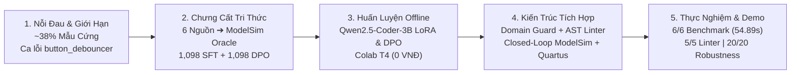

# KỊCH BẢN SLIDE BÁO CÁO ĐỒ ÁN 3 (CE118)
## ĐỀ TÀI: HỆ THỐNG TỰ ĐỘNG HÓA THIẾT KẾ VÀ KIỂM CHỨNG VI MẠCH TỪ ĐẶC TẢ NGÔN NGỮ TỰ NHIÊN (SPEC2RTL & PROMPT2SILICON)
**Giảng viên hướng dẫn:** TS. Nguyễn Văn Tình — Bộ môn Thiết kế Luận lý số (CE118)  
**Lộ trình trình bày:** Từ nỗi đau thiết kế & giới hạn mẫu cứng $\rightarrow$ Chưng cất tri thức (SFT + DPO) $\rightarrow$ Kiến trúc tích hợp (AST Linter + Domain Guard + Closed-Loop EDA + Quartus II) $\rightarrow$ Kết quả kiểm chứng & Demo thực tế.

---

### SƠ ĐỒ TỔNG QUAN XUYÊN SUỐT BUỔI BÁO CÁO (NARRATIVE ARC)



---

### SLIDE 1: TRANG TIÊU ĐỀ & MỤC TIÊU ĐỒ ÁN
* **Tiêu đề:** HỆ THỐNG TỰ ĐỘNG HÓA THIẾT KẾ VI MẠCH SPEC2RTL: TỪ CHƯNG CẤT TRI THỨC ĐẾN KIỂM CHỨNG EDA KHÉP KÍN
* **Nội dung hiển thị trên slide:**
  - **Môn học:** Đồ án 3 (CE118) — Thiết kế Luận lý số
  - **Giảng viên hướng dẫn:** TS. Nguyễn Văn Tình
  - **Sinh viên thực hiện:** [Họ và tên Sinh viên]
  - **Mục tiêu cốt lõi:** Chuyển hóa đặc tả ngôn ngữ tự nhiên (`.txt`, `.md`) thành mã Verilog synthesizable chuẩn IEEE 1364-2001, tự động kiểm thử trên **ModelSim-Altera**, tự sửa lỗi khép kín, và xuất sơ đồ nguyên lý **Quartus II 13.0sp1** (`.bdf`, `.vwf`, `.map.summary`).
  - **Trọng tâm báo cáo:** Chứng minh rõ cách xây dựng hệ thống từ **quy trình Chưng cất Tri thức (Knowledge Distillation)** kết hợp **tác tử kiểm chứng EDA** để giải quyết triệt để các lỗi phần cứng thực tế.
* **Hình ảnh / Sơ đồ gợi ý:**
  - Ảnh kiến trúc luồng tổng thể từ file thực tế trong repo: `` *(đường dẫn repo: `docs/images/pipeline_architecture_horizontal.png`)*.
  - Khối chuyển đổi 4 bước: `Đặc tả tự nhiên (specs/*.txt)` $\rightarrow$ `AI Chưng cất / Tổng hợp RTL` $\rightarrow$ `AST Linter & ModelSim Oracle` $\rightarrow$ `Sơ đồ BDF & Sóng VWF Quartus II`.
* **Lời thoại thuyết trình (~35s):**
  > *"Kính thưa Thầy TS. Nguyễn Văn Tình và quý Thầy Cô. Trong học phần Đồ án 3 (CE118), em xây dựng hệ thống **Spec2RTL & Prompt2Silicon** nhằm tự động hóa quy trình biến một bản đặc tả văn bản tự nhiên thành thiết kế phần cứng hoàn chỉnh có thể kiểm chứng ngay trên ModelSim và Quartus II.*  
  > *Trong buổi báo cáo hôm nay, em xin trình bày trọn vẹn lộ trình từ cách nhóm tạo ra năng lực thiết kế cho hệ thống thông qua quy trình **Chưng cất Tri thức (SFT LoRA + DPO)**, tích hợp cùng bộ bảo vệ **Domain Guard**, **AST Linter** và **vòng lặp kiểm chứng EDA khép kín**, cho đến kết quả đo kiểm thực nghiệm hiện tại."*

---

### SLIDE 2: NỖI ĐAU THIẾT KẾ VI MẠCH & CHIẾN LƯỢC PHÂN TÁCH 70/30
* **Tiêu đề:** Nỗi Đau Ngành Vi Mạch, Giới Hạn LLM Thông Thường & Chiến Lược 70/30
* **Nội dung hiển thị trên slide:**
  - **Nỗi đau thực tế (Verification Bottleneck):** Kỹ sư phần cứng tốn phần lớn thời gian viết lặp lại các khối mạch giao tiếp/điều khiển và gỡ lỗi mô phỏng.
  - **3 lý do LLM đa dụng (ChatGPT/Claude) thất bại khi viết Verilog:**
    1. *Ảo giác chân tín hiệu (Port Hallucination):* Tự thêm/bớt chân hoặc sai độ rộng bit so với đặc tả.
    2. *Lỗi ngữ nghĩa phần cứng ngầm:* Tạo chốt ẩn (**Inferred Latch**), chân đầu vào cô lập (**Dangling Pin**), hoặc gán blocking `=` trong khối tuần tự gây **Race Condition**.
    3. *Không có trọng tài EDA:* Chỉ sinh văn bản theo xác suất, không biên dịch/mô phỏng trên ModelSim hay tổng hợp trên Quartus.
  - **Chiến lược phân tách 70/30 (`reports/05_70_30_Chip_Partitioning_Commodity_AI.md`):**
    * **70% Khối hạ tầng phổ thông (AI tự động hóa):** Clock/Reset, UART/SPI/I2C, FIFO, Counter, FSM, ALU giao tiếp qua chuẩn Decoupled Ready/Valid Socket.
    * **30% Kiến trúc cốt lõi (Con người tập trung):** Systolic Array, khối tính toán INT8/BF16, PWL Activation, Ping-Pong DMA.
* **Hình ảnh / Sơ đồ gợi ý:**
  - Sơ đồ so sánh 2 cột: Cột trái *"LLM thông thường (Open-loop text)"* vs Cột phải *"Chiến lược 70/30 + EDA-in-the-loop"*.
  - Không dùng ảnh giả; vẽ trực quan biểu đồ tỷ lệ `70% Khối phổ thông (Tự động hóa)` / `30% Lõi đột phá (Kỹ sư tối ưu)`.
* **Lời thoại thuyết trình (~45s):**
  > *"Thưa Thầy, câu hỏi đầu tiên đặt ra là: tại sao không dùng trực tiếp các LLM phổ thông để xin code Verilog?*  
  > *Thực tế cho thấy thiết kế phần cứng cực kỳ khắt khe: chỉ cần AI bịa thêm một chân tín hiệu, thiếu nhánh `default` gây chốt ẩn, hay bỏ quên dây nối từ một ngõ vào, mạch vẫn có thể biên dịch được nhưng chạy sai hoàn toàn trên FPGA.*  
  > *Vì vậy, nhóm áp dụng chiến lược phân tách 70/30: giao 70% các khối hạ tầng phổ thông như UART, FSM, bộ đếm, bộ giải mã cho hệ thống Spec2RTL tự động sinh và kiểm chứng tuyệt đối, giúp người kỹ sư dồn 100% chất xám cho 30% kiến trúc lõi tính toán chuyên sâu."*

---

### SLIDE 3: HIỆN TRẠNG BAN ĐẦU & GIỚI HẠN CỦA PHƯƠNG PHÁP MẪU CỨNG (~38%)
* **Tiêu đề:** Giới Hạn Thực Nghiệm Của Mẫu Cứng & Ca Lỗi Điển Hình `button_debouncer`
* **Nội dung hiển thị trên slide:**
  - **Khảo sát trên bộ 100 đề bài chuẩn hóa (`docs/100_Prompt_Thiet_Ke_Mach.pdf`):**
    * **~38% bài toán đạt chuẩn:** Nằm trong 25 họ mạch kinh điển (Counter, Timer, ALU, Vending FSM, Traffic Light, UART TX...).
    * **~62% bài toán vượt ngoài mẫu cứng:** Khi gặp đề bài mới (ví dụ `button_debouncer`, MUX/DEMUX mở rộng, SPI, Arbiter), nhánh sinh generic dễ tạo logic giả lập hoặc bỏ sót chân.
  - **Ca thất bại thực nghiệm do TS. Nguyễn Văn Tình chỉ ra (`button_debouncer`):**
    * Chân đầu vào `btn_in` bị cô lập hoàn toàn (**Dangling Input Pin**), không đi vào logic khử rung.
    * Ngõ ra chỉ lật trạng thái giả tạo, trong khi Testbench sơ sài vẫn báo **PASS 100% giả tạo**.
  - **Kết luận chuyển hướng:** Không thể viết tay hàng nghìn template $\rightarrow$ Phải **chưng cất tri thức** sang mô hình ngôn ngữ cục bộ chuyên biệt kết hợp **AST Linter** bắt lỗi phần cứng.
* **Hình ảnh / Sơ đồ gợi ý:**
  ```mermaid
  flowchart LR
      A["100 Đề Bài Chuẩn Hóa<br/>(docs/100_Prompt_Thiet_Ke_Mach.pdf)"] --> B["~38% Mẫu Kinh Điển<br/>(25 Họ Mạch) ➔ PASS"]
      A --> C["~62% Mạch Mới / Biến Thể<br/>➔ Chạm Trần Template"]
      C --> D["Ca Lỗi button_debouncer<br/>btn_in cô lập (Dangling Pin)<br/>Testbench ngây thơ báo PASS giả"]
      D --> E["ĐỘNG LỰC ĐỘT PHÁ<br/>Chưng cất Tri thức + DPO + AST Linter"]
  ```
* **Lời thoại thuyết trình (~45s):**
  > *"Ở giai đoạn đầu, khi kiểm thử phương pháp dựa trên mẫu cứng trên bộ 100 đề bài chuẩn hóa của đồ án, hệ thống chỉ xử lý tốt khoảng 38% bài toán thuộc 25 họ mạch quen thuộc; 62% bài toán còn lại rơi vào giới hạn của hàm sinh generic.*  
  > *Đặc biệt, qua phản biện trực tiếp của Thầy Tình trên bài toán `button_debouncer`, nhóm thấy rõ nhược điểm chí mạng: chân `btn_in` bị bỏ lơ lửng không nối vào logic, nhưng testbench đơn giản vẫn báo PASS giả. Chính bài học thực nghiệm này là lý do nhóm chuyển sang xây dựng quy trình Chưng cất Tri thức và bộ phân tích tĩnh AST Linter."*

---

### SLIDE 4: TỔNG QUAN QUY TRÌNH CHƯNG CẤT TRI THỨC (HOW THE SYSTEM WAS BUILT)
* **Tiêu đề:** Lộ Trình Tạo Ra Hệ Thống: 5 Bước Chưng Cất Tri Thức & Căn Chỉnh Phần Cứng
* **Nội dung hiển thị trên slide:**
  - **Mục tiêu:** Chưng cất năng lực suy luận phần cứng từ nhiều nguồn tri thức chuẩn thành mô hình **3B chạy 100% Offline**, chi phí huấn luyện **0 VNĐ**, biết né lỗi vi mạch.
  - **5 bước thực thi khép kín trong `training/` & `models/`:**
    1. **Thu thập & Mở rộng dữ liệu:** Hợp nhất **6 nguồn** trong `knowledge_base/hardware_db.json` (539 mẫu) + augmentation chuẩn CE118 (`training/prepare_dataset_group1.py`) + `VeriPrefer` (`training/integrate_veriprefer.py`).
    2. **Lọc ModelSim Truth Oracle & Khử trùng lặp MD5:** `training/filter_dataset_with_modelsim.py` $\rightarrow$ **1,098 mẫu sạch (99.8%)** trong `training/dataset_clean_verified.json`.
    3. **Tạo cặp DPO Preference tiêm lỗi phần cứng:** `training/build_dpo_dataset.py` $\rightarrow$ **1,098 cặp Chosen/Rejected** trong `training/dataset_dpo_preference.json`.
    4. **Huấn luyện SFT LoRA & DPO Alignment:** Trên Google Colab GPU T4 dùng Unsloth 4-bit (`train_spec2rtl_qwen3b_colab.ipynb` & `train_spec2rtl_qwen3b_dpo_colab.ipynb`).
    5. **Đóng gói trọng số & Tích hợp hệ thống:** Xuất adapter tại `models/qwen2.5_3b_verilog_lora/` & `models/qwen2.5_3b_verilog_dpo/`, chạy suy luận qua `models/run_inference.py` kết hợp bộ điều phối `agent/`.
* **Hình ảnh / Sơ đồ gợi ý:**
  ```mermaid
  flowchart LR
      S1["Bước 1: 6 Nguồn + Aug<br/>hardware_db.json (539)<br/>prepare_dataset_group1.py<br/>integrate_veriprefer.py"] --> S2["Bước 2: Truth Oracle<br/>ModelSim vlog.exe + Linter<br/>+ MD5 Dedup ➔ 1,098 mẫu"]
      S2 --> S3["Bước 3: DPO Dataset<br/>Tiêm 3 lỗi phần cứng<br/>➔ 1,098 cặp Chosen/Rejected"]
      S3 --> S4["Bước 4: Colab T4 (0 VNĐ)<br/>SFT LoRA (lr=2e-4)<br/>➔ DPO (beta=0.1, lr=5e-6)"]
      S4 --> S5["Bước 5: Offline Weights<br/>qwen2.5_3b_verilog_lora<br/>qwen2.5_3b_verilog_dpo"]
  ```
* **Lời thoại thuyết trình (~40s):**
  > *"Để Thầy thấy rõ cách hệ thống được tạo ra từ gốc, đây là toàn cảnh 5 bước Chưng cất Tri thức của nhóm.*  
  > *Thay vì dùng dữ liệu thô trên mạng vốn chứa rất nhiều mã Verilog không tổng hợp được, nhóm đi từ thu thập 6 nguồn chuẩn, ép toàn bộ qua 'bộ lọc chân lý' ModelSim để còn 1,098 mẫu sạch, rồi chủ động tiêm lỗi phần cứng để tạo 1,098 cặp DPO dạy AI biết phân biệt code đúng và code lỗi. Toàn bộ quá trình huấn luyện SFT và DPO được thực hiện miễn phí trên Colab T4 rồi đóng gói trọng số chạy offline."*

---

### SLIDE 5: BƯỚC 1 & 2 — THU THẬP 6 NGUỒN TRI THỨC & LỌC MODELSIM TRUTH ORACLE
* **Tiêu đề:** Thu Thập Đa Nguồn, Gắn CoT 3 Bước & Thẩm Định Bằng ModelSim Truth Oracle
* **Nội dung hiển thị trên slide:**
  - **Bước 1 — Nguồn gốc dữ liệu thô & Augmentation:**
    * **6 nguồn trong `knowledge_base/hardware_db.json` (539 mẫu):** `NVIDIA VerilogEval` (156), `AbiralArch CVDP Benchmark` (119), `HuggingFace Verilog-Instruct-60k` (112), `CityU HK VeriPrefer` (100), `HKUST RTLLM` (50), `Spec2RTL Verified Library` (2).
    * **Tổng hợp & gắn Hardware CoT 3 bước (`training/prepare_dataset_group1.py` — 3,094 dòng):** Kết hợp `collect_from_hardware_db()`, `collect_from_specs_dir()` (6 benchmark `specs/*.txt`), `generate_full_scale_augmentation()` (8 nhóm), `generate_advanced_ce118_suite()` (9 nhóm), `generate_protocols_and_coprocessors_suite()` (SPI, UART RX, VGA, CRC, MAC, FIFO...) + nạp thêm `CatIIIIIIII/VeriPrefer` (`rtllm2.json` 50 bài & `veriloghuman.json` 40 bài đầu) qua `training/integrate_veriprefer.py`.
  - **Bước 2 — Lọc ModelSim Truth Oracle & Khử trùng lặp (`training/filter_dataset_with_modelsim.py`):**
    * Biên dịch từng mẫu bằng `vlog.exe -work work` (timeout 10s, bắt buộc `returncode == 0`, có `"-- Compiling"`, không có `** Error:`/`** Fatal:`).
    * Kiểm tra `check_linter()` (cặp `module`/`endmodule`, cân bằng `begin`/`end`, `case` có `default:`) và khử trùng lặp theo `id` + băm **MD5** mã đã chuẩn hóa (`normalize_code`).
  - **Kết quả (`training/REPORT_NHOM_1_DATASET.md` & `training/dataset_clean_verified.json`):**
    * **1,100 ứng viên** $\rightarrow$ loại **2 mẫu trùng lặp (0.2%)**, 0 lỗi linter sót $\rightarrow$ **1,098 mẫu sạch (99.8%)** đạt chuẩn `PASS_100_MODELSIM_VLOG` & `CLEAN_0_LATCH_0_DANGLING_PIN`, phân bố trên **26 categories** (Synthesized CE118 Suite: 791, VerilogEval: 94, Verilog-Instruct-60k: 87, VeriPrefer: 75, RTLLM: 43, Spec2RTL Benchmarks: 6, Verified Library: 2).
* **Hình ảnh / Sơ đồ gợi ý:**
  - Biểu đồ phễu dữ liệu (Data Funnel): `539 mẫu DB + Augmentation + VeriPrefer` $\rightarrow$ `1,100 ứng viên` $\rightarrow$ `ModelSim vlog.exe + check_linter() + MD5 Dedup` $\rightarrow$ **`1,098 mẫu sạch (99.8%)`**.
  - Trích dẫn cấu trúc chuẩn SFT (`instruction`, `input`, `output` kèm CoT 3 bước `generate_cot_explanation`).
* **Lời thoại thuyết trình (~50s):**
  > *"Đi vào chi tiết Bước 1 và Bước 2: điểm xuất phát của nhóm là `hardware_db.json` gồm 539 mẫu từ 6 nguồn nghiên cứu uy tín như NVIDIA VerilogEval, VeriPrefer, RTLLM, CVDP, Verilog-Instruct-60k và thư viện nội bộ Spec2RTL.*  
  > *Sau đó, script `prepare_dataset_group1.py` mở rộng thêm các họ mạch đặc thù môn CE118 như CRC, SPI, UART, VGA, FIFO kèm chuỗi suy luận CoT 3 bước, và `integrate_veriprefer.py` bổ sung thêm mẫu từ VeriPrefer. Tất cả 1,100 ứng viên được đưa qua bộ lọc Truth Oracle bằng chính trình biên dịch `vlog.exe` của ModelSim kết hợp khử trùng lặp MD5. Kết quả giữ lại đúng **1,098 mẫu sạch** trên 26 nhóm mạch, bảo đảm 100% biên dịch thành công trước khi đưa đi huấn luyện."*

---

### SLIDE 6: BƯỚC 3 — TẠO 1,098 CẶP DPO CHOSEN/REJECTED TIÊM LỖI PHẦN CỨNG
* **Tiêu đề:** Căn Chỉnh Nhận Thức Phần Cứng: Sinh 1,098 Cặp DPO Bằng Đột Biến Tiêm Lỗi
* **Nội dung hiển thị trên slide:**
  - **Vì sao SFT chưa đủ?** SFT chỉ dạy mô hình bắt chước mẫu đúng; theo nghiên cứu **VeriPrefer** (`reports/06_VeriPrefer_ClosedLoop_Feedback.md`), cần tín hiệu đối lập (**Chosen vs Rejected**) để mô hình biết chủ động tránh các lỗi phần cứng tinh vi.
  - **Cơ chế đột biến trong `training/build_dpo_dataset.py` $\rightarrow$ `training/dataset_dpo_preference.json`:**
    * Từ 1,098 mẫu sạch (**Chosen**), hệ thống tự động tiêm các lỗi phần cứng kinh điển để tạo phiên bản **Rejected**:
      1. `mutate_inject_dangling_pin` (**`DANGLING_PIN`: 933 cặp**) — Cô lập chân tín hiệu đầu vào/ra (như ca lỗi `button_debouncer`).
      2. `mutate_inject_latch` (**`INFERRED_LATCH`: 86 cặp**) — Xóa nhánh `default:` hoặc `else` trong khối tổ hợp.
      3. `mutate_inject_blocking_assignment` (**`BLOCKING_IN_SEQUENTIAL`: 56 cặp**) — Đổi `<=` thành `=` trong khối `posedge clk`.
      4. Fallback lỗi cấu trúc/logic: **`SYNTAX_TRUNCATED` (18 cặp)** và **`FUNCTIONAL_BUG` (5 cặp)**.
    * **Tổng cộng:** **1,098 cặp `(prompt, chosen, rejected)`** sạch và cân đối cho huấn luyện DPO.
* **Hình ảnh / Sơ đồ gợi ý:**
  - Bảng phân bố thực tế 1,098 cặp DPO trong `training/dataset_dpo_preference.json`:
    | Loại lỗi tiêm vào (`Rejected`) | Số lượng cặp | Tỷ lệ |
    | :--- | :---: | :---: |
    | `DANGLING_PIN` (Chân lơ lửng) | 933 | 85.0% |
    | `INFERRED_LATCH` (Chốt ẩn) | 86 | 7.8% |
    | `BLOCKING_IN_SEQUENTIAL` (Lỗi gán `=`) | 56 | 5.1% |
    | `SYNTAX_TRUNCATED` + `FUNCTIONAL_BUG` | 18 + 5 | 2.1% |
* **Lời thoại thuyết trình (~45s):**
  > *"Sang Bước 3, để mô hình không mắc lại các lỗi mà Thầy đã chỉ ra như chân lơ lửng hay chốt ẩn, nhóm viết script `build_dpo_dataset.py` biến đổi trực tiếp 1,098 mẫu sạch thành **1,098 cặp dữ liệu DPO**.*  
  > *Trong mỗi cặp, phần Chosen là mã chuẩn đã qua ModelSim, còn phần Rejected được tạo bằng cách cố tình tiêm 3 lỗi phần cứng phổ biến nhất: chân lơ lửng (933 cặp), chốt ẩn (86 cặp) và gán blocking trong khối tuần tự (56 cặp), cùng 23 cặp lỗi cú pháp/logic. Nhờ vậy, mô hình được dạy trực tiếp điều gì là 'tối kỵ' trong thiết kế RTL."*

---

### SLIDE 7: BƯỚC 4 & 5 — HUẤN LUYỆN SFT LORA, DPO ALIGNMENT & ĐÓNG GÓI OFFLINE
* **Tiêu đề:** Huấn Luyện Qwen2.5-Coder-3B (SFT LoRA $\rightarrow$ DPO) & Đóng Gói Chạy Offline
* **Nội dung hiển thị trên slide:**
  - **Hạ tầng & Cấu hình chung (0 VNĐ trên Google Colab GPU T4):**
    * Base model: `unsloth/Qwen2.5-Coder-3B-Instruct-bnb-4bit` (`load_in_4bit=True`, `max_seq_length=2048`).
    * Cấu hình LoRA: `r=16`, `lora_alpha=16`, `lora_dropout=0`, `target_modules=["q_proj","k_proj","v_proj","o_proj","gate_proj","up_proj","down_proj"]`, `optim="adamw_8bit"`, effective batch = `8` (`batch_size=2 × grad_accum=4`).
  - **Hai giai đoạn huấn luyện nối tiếp:**
    1. **SFT LoRA (`training/train_spec2rtl_qwen3b_colab.ipynb`):** Template `qwen-2.5`, 1,098 mẫu sạch, `SFTTrainer`, `1 epoch`, `learning_rate=2e-4`, `warmup_steps=5`.
    2. **DPO Alignment (`training/train_spec2rtl_qwen3b_dpo_colab.ipynb`):** `PatchDPOTrainer()` + `DPOTrainer`, 1,098 cặp DPO, `ref_model=None`, `beta=0.1`, `learning_rate=5e-6`, `1 epoch`, `max_prompt_length=512`, `max_length=1024`.
  - **Phân tích biểu đồ hội tụ thực nghiệm (`docs/dpo_loss_convergence.png`):**
    * Quá trình DPO chạy **137 bước** (step 1 $\rightarrow$ 137): Loss khởi đầu quanh **~0.693** trong ~12 bước warmup đầu, sau đó giảm dốc ổn định xuống vùng **~0.23–0.48** cuối kỳ và kết thúc tại **~0.29** (step 137).
  - **Đóng gói chạy Offline (`models/`):**
    * Xuất 2 bộ trọng số độc lập: `models/qwen2.5_3b_verilog_lora/` và `models/qwen2.5_3b_verilog_dpo/` (mỗi `adapter_model.safetensors` **~114.25 MB** / 119,801,528 bytes, `peft_version="0.21.2"`).
    * Nạp suy luận offline qua `models/run_inference.py` (`temperature=0.2`, `top_p=0.9`, `max_new_tokens=1024`), có Domain Guard và fallback an toàn về `agent/rtl_generator.py` nếu thiếu PyTorch/GPU.
* **Hình ảnh / Sơ đồ gợi ý:**
  - Biểu đồ hội tụ DPO Loss thực tế từ repo: `` *(đường dẫn repo: `docs/dpo_loss_convergence.png`)*.
* **Lời thoại thuyết trình (~50s):**
  > *"Bước 4 và Bước 5 hoàn thiện bộ não AI của hệ thống với chi phí 0 đồng trên GPU T4 của Google Colab nhờ thư viện Unsloth 4-bit.*  
  > *Đầu tiên, mô hình `Qwen2.5-Coder-3B-Instruct` được huấn luyện SFT LoRA (rank 16) trên 1,098 mẫu sạch để nắm vững cấu trúc Verilog và suy luận CoT. Tiếp theo, mô hình bước vào pha DPO Alignment với hệ số `beta=0.1` trên 1,098 cặp dữ liệu tiêm lỗi.*  
  > *Như Thầy thấy trên biểu đồ thực nghiệm `dpo_loss_convergence.png`: qua 137 bước huấn luyện, đường DPO Loss giảm đều đặn từ mức khởi điểm lý thuyết ~0.693 xuống còn khoảng 0.29 ở cuối chu kỳ. Sau khi train xong, hai bộ adapter LoRA (~114.25 MB mỗi bộ) được đóng gói về máy local tại thư mục `models/` để chạy offline bảo mật hoàn toàn mã nguồn thiết kế."*

---

### SLIDE 8: KIẾN TRÚC HỆ THỐNG TÍCH HỢP HIỆN TẠI (HYBRID AI + EDA PIPELINE)
* **Tiêu đề:** Kiến Trúc Tích Hợp Hiện Tại: Phối Hợp Bộ Não Chưng Cất & Đường Ống EDA Khép Kín
* **Nội dung hiển thị trên slide:**
  - **2 lớp năng lực phối hợp minh bạch trong mã nguồn:**
    1. **Nhánh AI Chưng cất Offline (`models/run_inference.py`):**
       * Chạy `SpecAnalyzer.check_unsupported_domain()` $\rightarrow$ gọi `Qwen2.5-Coder-3B-Instruct` + adapter DPO `models/qwen2.5_3b_verilog_dpo/` $\rightarrow$ tự động fallback về `RTLGenerator.generate_from_spec()` nếu môi trường máy cục bộ không nạp được PyTorch/Transformers.
    2. **Nhánh Điều phối EDA Toàn trình (`agent/run_spec2rtl.py` — trong thư mục `agent/` gồm 13 module lõi/tiện ích & 2 script kiểm thử):**
       * **Pha 1 (`spec_analyzer.py`):** Domain Guard + bóc tách cổng I/O 3 tầng *(ngoài ra `knowledge_matcher.py` là module tra cứu `knowledge_base/hardware_db.json` độc lập ngoài luồng `run_spec2rtl.py`)*.
       * **Pha 2 (`rtl_generator.py`, `tb_generator.py`):** Định tuyến 25+ nhóm mạch, ép khớp cổng bằng `RTLPortEnforcer.enforce()`, sinh Self-Checking Testbench.
       * **Pha 3 (`verilog_linter.py`):** Kiểm tra tĩnh AST Linter trước khi mô phỏng.
       * **Pha 4 (`simulator.py`, `reflection_loop.py`, `eda_finder.py`):** Chạy ModelSim/Icarus + tự vá lỗi vòng lặp khép kín.
       * **Pha 5 (`bdf_generator.py`, `vwf_generator.py`, `port_auditor.py`, `synthesis_profiler.py`):** Xuất Project Quartus II, Schematic BDF, Waveform VWF, kiểm toán 4 chiều & đo tài nguyên Cyclone II.
* **Hình ảnh / Sơ đồ gợi ý:**
  - Sơ đồ kiến trúc chiều ngang chính thức: `` *(đường dẫn repo: `docs/images/pipeline_architecture_horizontal.png`)*.
* **Lời thoại thuyết trình (~45s):**
  > *"Sau khi có trọng số chưng cất, nhóm tích hợp mô hình vào kiến trúc hệ thống tổng thể. Em xin trình bày trung thực cấu trúc chạy hiện tại của phần mềm gồm hai lớp gắn kết chặt chẽ:*  
  > *Một là module `models/run_inference.py` chạy trực tiếp mô hình 3B gắn adapter DPO offline để sinh Verilog từ prompt, đồng thời có cơ chế fallback an toàn về `RTLGenerator` khi chạy trên máy không có GPU.*  
  > *Hai là đường ống điều phối trung tâm `agent/run_spec2rtl.py` kết nối toàn bộ các khâu: phân tích đặc tả, ép chuẩn chân tín hiệu với `RTLPortEnforcer`, quét AST Linter, mô phỏng sửa lỗi khép kín trên ModelSim và bàn giao sơ đồ Quartus II."*

---

### SLIDE 9: BẢO VỆ BIÊN & KIỂM TRA TĨNH: DOMAIN GUARD & AST LINTER
* **Tiêu đề:** Hai Lớp Lá Chắn Kỹ Thuật: Domain Guard (`spec_analyzer.py`) & AST Linter (`verilog_linter.py`)
* **Nội dung hiển thị trên slide:**
  - **Lá chắn 1 — Domain Guard & Bóc tách 3 tầng (`agent/spec_analyzer.py`):**
    * Hỗ trợ tiếng Việt có dấu & không dấu (`remove_vietnamese_accents`).
    * `check_unsupported_domain()` chặn sớm 3 miền ngoài phạm vi RTL số: `ANALOG_AMS` (op-amp, analog, bandgap...), `HIGH_SPEED_PHY` (PCIe/DDR/SerDes/USB3 PHY), và `IRRELEVANT_INPUT` (văn bản không chứa từ khóa phần cứng / không có cổng).
    * `is_30_percent_architecture()` chặn sinh nguyên khối 1-prompt cho hệ thống phức hợp `SOC_AI` (`top_soc`, `ai accelerator`, `systolic array`, `dma+relu+ai`).
    * `extract_ports()` bóc tách cổng 3 tầng: Bảng Markdown $\rightarrow$ Danh sách gạch đầu dòng/số $\rightarrow$ Văn xuôi.
  - **Lá chắn 2 — Bộ phân tích tĩnh AST Linter thuần Python (`agent/verilog_linter.py`):**
    * **Không phụ thuộc PyVerilog/C++**, `extract_module_info()` hỗ trợ cả **ANSI-2001** và **Legacy-1995**.
    * `check_dangling_pins()`: Bắt chết **`DANGLING_INPUT`** (cổng vào không tham gia biểu thức logic nào) và **`UNASSIGNED_OUTPUT`** (cổng ra không được gán).
    * `check_inferred_latches_and_races()`: Bắt **`INFERRED_LATCH`** (`case` thiếu `default:`, `if` thiếu `else` không có gán mặc định), **`BLOCKING_IN_SEQUENTIAL`** (`=` trong `posedge/negedge`), **`NONBLOCKING_IN_COMBINATIONAL`** (`<=` trong khối tổ hợp).
    * `lint_check()`: Kiểm tra thêm cân bằng `begin/end`, `case/endcase`, `module/endmodule` và `%!` trong `$display`.
* **Hình ảnh / Sơ đồ gợi ý:**
  ```mermaid
  flowchart TD
      In["Đặc tả đầu vào (.txt / .md)"] --> DG{"Domain Guard<br/>spec_analyzer.py"}
      DG -->|"ANALOG_AMS / HIGH_SPEED_PHY<br/>IRRELEVANT / SOC_AI"| Reject["Từ chối an toàn + Giải thích"]
      DG -->|"Hợp lệ (RTL số)"| Gen["Sinh RTL + RTLPortEnforcer"]
      Gen --> AST{"AST Linter (Thuần Python)<br/>verilog_linter.py"}
      AST -->|"DANGLING_INPUT / UNASSIGNED_OUTPUT<br/>INFERRED_LATCH / BLOCKING_IN_SEQUENTIAL"| Fix["Chặn & Yêu cầu sửa trước khi nạp EDA"]
      AST -->|"0 Lỗi (CLEAN)"| Sim["Đưa vào ModelSim Simulator"]
  ```
* **Lời thoại thuyết trình (~50s):**
  > *"Để hệ thống không bao giờ 'nói bừa' hay để lọt lỗi phần cứng như trước đây, nhóm xây dựng hai lớp lá chắn liên tiếp.*  
  > *Ở đầu vào, `spec_analyzer.py` kích hoạt Domain Guard hỗ trợ cả tiếng Việt có dấu và không dấu để từ chối các đề bài ngoài phạm vi RTL như mạch Analog, High-speed PHY hay văn bản phi kỹ thuật, đồng thời tách kiến trúc SoC AI lớn thay vì cố sinh nguyên khối một lần.*  
  > *Ở đầu ra của khâu sinh mã, `verilog_linter.py` đóng vai trò bộ AST Linter thuần Python hỗ trợ cả chuẩn Verilog 1995 và 2001, tự động quét sạch 3 lỗi chí mạng: chân lơ lửng (`DANGLING_INPUT`/`UNASSIGNED_OUTPUT`), chốt ẩn (`INFERRED_LATCH`) và lỗi race condition (`BLOCKING_IN_SEQUENTIAL`) trước khi đưa sang ModelSim."*

---

### SLIDE 10: VÒNG LẶP PHẢN HỒI KHÉP KÍN MODELSIM & TRỰC QUAN HÓA QUARTUS II
* **Tiêu đề:** Kiểm Chứng Khép Kín Trên ModelSim & Bàn Giao Trực Quan Trên Quartus II
* **Nội dung hiển thị trên slide:**
  - **Vòng lặp phản hồi EDA khép kín (`agent/simulator.py`, `agent/reflection_loop.py`, `agent/eda_finder.py`):**
    * `EDASimulator` tự tìm và gọi ModelSim/Icarus (`timeout=60s`), kiểm tra chặt cả lỗi biên dịch và lỗi runtime (`FAIL`, `MISMATCH`, `Failed Assertions`) — loại trừ hoàn toàn tình trạng PASS giả.
    * `ReflectionAgent` chạy tối đa `max_retries=3` vòng tự chẩn đoán và vá lỗi (sửa tên instance, `%!` trong `$display`, thiếu dấu phẩy, tái tạo Testbench khớp cổng).
    * Nền tảng nghiên cứu **VeriPrefer** (`reports/06_VeriPrefer_ClosedLoop_Feedback.md`): Thử nghiệm fault-injection trên 50 thiết kế cho thấy cơ chế vòng lặp EDA giúp tỷ lệ pass hội tụ từ **44.0% (22/50, vòng 0)** $\rightarrow$ **92.0% (vòng 1)** $\rightarrow$ **98.0% (vòng 2)** $\rightarrow$ **100.0% (50/50, vòng 3)**.
  - **Trực quan hóa & Kiểm toán Quartus II (`bdf_generator.py`, `vwf_generator.py`, `port_auditor.py`, `synthesis_profiler.py`):**
    * Tự động tạo Project `.qpf`/`.qsf` nhắm mục tiêu FPGA **Altera Cyclone II (`EP2C35F672C6`)**, top module `sch_<TenMach>`.
    * Sinh file Symbol `.bsf`, Sơ đồ khối nguyên lý `.bdf`, và sóng `Waveform.vwf` (đọc trực tiếp chuyển trạng thái từ file `.vcd` của ModelSim).
    * `PortAuditor.audit()` đối soát toàn vẹn 4 chiều **Spec $\equiv$ RTL $\equiv$ BSF $\equiv$ BDF**; `SynthesisProfiler` gọi `quartus_map.exe` (`timeout=60s`) đọc `.map.summary` (có dự phòng `estimate_static_resources()`).
* **Hình ảnh / Sơ đồ gợi ý:**
  ```mermaid
  flowchart LR
      RTL["RTL + Testbench<br/>(Sạch AST Linter)"] --> SIM["EDASimulator<br/>ModelSim vlog/vsim (60s)"]
      SIM -->|"Lỗi / FAIL / MISMATCH"| REF["ReflectionAgent<br/>(max_retries = 3)"]
      REF --> RTL
      SIM -->|"100% Functional Pass"| Q["Quartus II Toolchain<br/>Cyclone II EP2C35F672C6"]
      Q --> OUT1["bdf_generator.py ➔ .bsf, .bdf"]
      Q --> OUT2["vwf_generator.py ➔ Waveform.vwf (từ .vcd)"]
      Q --> OUT3["port_auditor.py ➔ Đối soát 4 chiều"]
      Q --> OUT4["synthesis_profiler.py ➔ quartus_map.exe"]
  ```
* **Lời thoại thuyết trình (~50s):**
  > *"Sau khi mã Verilog vượt qua AST Linter, hệ thống không tin mù quáng vào AI mà đưa ngay sang trọng tài ModelSim qua `simulator.py`. Nếu phát hiện sai lệch assertion hoặc lỗi biên dịch, `reflection_loop.py` sẽ tự động đọc log và vá code tối đa 3 vòng lặp cho tới khi đạt 100% Functional Pass.*  
  > *Khi mô phỏng đạt chuẩn, hệ thống tự động dựng toàn bộ hồ sơ dự án Quartus II cho chip FPGA Cyclone II `EP2C35F672C6`: từ sơ đồ nguyên lý `.bdf`, dạng sóng `.vwf` trích từ `.vcd`, đến việc kiểm toán đối chiếu 4 chiều Spec-RTL-BSF-BDF và chạy `quartus_map.exe` đo đạc chính xác số Logic Elements và Flip-Flops thực tế."*

---

### SLIDE 11: KẾT QUẢ THỰC NGHIỆM & KIỂM CHỨNG HIỆN TẠI
* **Tiêu đề:** Kết Quả Thực Nghiệm Toàn Diện: 6/6 Benchmark (54.89s), 5/5 Linter & 20/20 Robustness
* **Nội dung hiển thị trên slide:**
  - **1. Bảng kết quả 6 mạch Benchmark thực tế (`reports/REPORT_TUAN_2_BENCHMARK.md` & `.map.summary` Quartus II trên Cyclone II `EP2C35F672C6`):**

| ID | Tên Vi Mạch (Module) | Kiến Trúc | ModelSim Pass@1 | AST Linter | Logic Elements (LEs) | Flip-Flops (FFs) | I/O Pins | Thời Gian |
| :---: | :--- | :--- | :---: | :---: | :---: | :---: | :---: | :---: |
| 1 | `uart_tx_8bit` | Bộ phát UART TX 8-bit | **100% PASS** | 0 lỗi | 28 LEs (20 comb, 17 reg) | 17 FFs | 13 Pins | 26.5s |
| 2 | `button_debouncer` | Khử rung phím bấm *(Ca của Thầy)* | **100% PASS** | 0 lỗi | 6 LEs (2 comb, 6 reg) | 6 FFs | 5 Pins | 7.65s |
| 3 | `bcd_to_7seg_anode` | Giải mã BCD sang LED 7 đoạn | **100% PASS** | 0 lỗi | 7 LEs (7 comb, 0 reg) | 0 FFs | 11 Pins | 4.81s |
| 4 | `canh_bao_an_ninh_bao_chay_nha_thong_minh` | FSM cảnh báo an ninh & cháy | **100% PASS** | 0 lỗi | 4 LEs (2 comb, 4 reg) | 4 FFs | 9 Pins | 4.82s |
| 5 | `decoder_3to8` | Giải mã địa chỉ 3 sang 8 | **100% PASS** | 0 lỗi | 8 LEs (8 comb, 0 reg) | 0 FFs | 12 Pins | 6.56s |
| 6 | `digital_lock_fsm` | Khóa số điện tử mật mã FSM | **100% PASS** | 0 lỗi | 25 LEs (25 comb, 9 reg) | 9 FFs | 14 Pins | 4.55s |

  - **Tổng hợp 6 mạch benchmark:** **6/6 (100.0%) PASS** trên ModelSim và AST Linter, tổng thời gian chạy toàn trình **54.89 giây** (nâng tỷ lệ đạt chuẩn từ **~38%** lên **100%** trên bộ benchmark).
  - **2. Kết quả chạy kiểm thử xác thực trực tiếp trên hệ thống hiện tại:**
    * `python agent/test_group3_linter.py` $\rightarrow$ **5/5 PASS (100%)** (Clean Counter 4-bit, Dangling Pin `btn_in`/`btn_pressed_pulse`, Inferred Latch `case`/`if`, Race Condition `BLOCKING_IN_SEQUENTIAL`, Synthesis Profiler `bcd_to_7seg_anode.v`).
    * `python agent/test_robustness_battery.py` $\rightarrow$ **20/20 PASS (100.0%)** (`TC01_Stopwatch_7Seg` $\rightarrow$ `TC20_CRC8_Generator`) qua trích xuất cổng, `RTLGenerator` + `RTLPortEnforcer`, `VerilogLinter.sanitize_file`, tạo `.bsf`/`.bdf` và `PortAuditor.audit`.
    * Quét trực tiếp `VerilogLinter.lint_file` trên cả 6 file `src/*.v` $\rightarrow$ **6/6 PASS** (0 latches, 0 dangling pins, 0 race conditions).
* **Hình ảnh / Sơ đồ gợi ý:**
  - Bảng so sánh đối chuẩn trực quan:
    * **Trước (Template cứng):** ~38% trên 100 prompt, lỗi `DANGLING_INPUT` ở `button_debouncer`.
    * **Hiện tại:** **6/6 (100%)** Benchmark (**54.89s**), **5/5** AST Linter, **20/20** Robustness Battery.
* **Lời thoại thuyết trình (~55s):**
  > *"Đây là bảng kết quả thực nghiệm tổng hợp trên toàn bộ hệ thống hiện tại, đã được đối soát trực tiếp với file `.map.summary` từ Quartus II trên chip Cyclone II và chạy lại các bộ kiểm thử.*  
  > *Trên 6 bài toán đặc tả thực tế gồm UART TX, khử rung nút bấm, giải mã LED 7 đoạn, hệ thống cảnh báo an ninh nhà thông minh, bộ giải mã 3 sang 8 và khóa số FSM, hệ thống đạt **6/6 (100%) ModelSim Pass@1** và **0 lỗi AST Linter** trong tổng thời gian **54.89 giây**.*  
  > *Song song đó, bộ test chuyên biệt `agent/test_group3_linter.py` đạt **5/5 PASS**, bộ kiểm thử hồi quy toàn diện `agent/test_robustness_battery.py` đạt **20/20 PASS**, và cả 6 file Verilog trong `src/` đều sạch tuyệt đối latch, dangling pin và race condition."*

---

### SLIDE 12: DEMO TRỰC TIẾP 1 — KHẮC PHỤC TRIỆT ĐỂ `button_debouncer`
* **Tiêu đề:** Demo Trực Quan Ca Phản Biện Của Thầy: `button_debouncer` Sạch Chân Lơ Lửng
* **Nội dung hiển thị trên slide:**
  - **Đầu vào đặc tả (`specs/b.txt`):** `clk`, `rst`, `btn_in` $\rightarrow$ `btn_clean`, `btn_pressed_pulse` (lọc rung ổn định, xuất xung 1 chu kỳ `clk` khi nhấn xuống).
  - **Lệnh thực thi trực tiếp:**
    ```bash
    python agent/run_spec2rtl.py specs/b.txt --gui
    ```
  - **Minh chứng thực tế trong mã nguồn `src/button_debouncer.v`:**
    ```verilog
    shift_reg <= {shift_reg[1:0], btn_in};
    if (shift_reg == 3'b111)      btn_clean <= 1'b1;
    else if (shift_reg == 3'b000) btn_clean <= 1'b0;
    btn_pressed_pulse <= (btn_clean && !btn_clean_prev);
    ```
  - **4 điểm nghiệm thu tại chỗ:**
    1. **AST Linter:** **0 lỗi** (triệt tiêu hoàn toàn `DANGLING_INPUT: btn_in`).
    2. **ModelSim GUI & VCD (`sim/button_debouncer.vcd`):** Quan sát trực tiếp `btn_in` nảy nhiễu, `btn_clean` giữ ổn định và `btn_pressed_pulse` phát đúng 1 xung `clk`.
    3. **Quartus II Schematic & Waveform:** Mở `quartus/button_debouncer/sch_button_debouncer.bdf` và `quartus/button_debouncer/Waveform.vwf`.
    4. **Quartus Synthesis (`quartus/button_debouncer/ButtonDebouncer.map.summary`):** **6 LEs** (2 comb, 6 reg), **6 FFs**, **5 Pins** trong **7.65s**.
* **Hình ảnh / Sơ đồ gợi ý:**
  - Khung hiển thị song song (Side-by-side Demo Card): Trái là đoạn RTL `src/button_debouncer.v` tô đậm dòng `shift_reg <= {shift_reg[1:0], btn_in};`; Phải là hướng dẫn mở trực tiếp ModelSim GUI (`--gui`) và sơ đồ `quartus/button_debouncer/sch_button_debouncer.bdf` + `quartus/button_debouncer/Waveform.vwf`.
* **Lời thoại thuyết trình (~50s):**
  > *"Sau đây em xin demo trực tiếp ca kiểm thử quan trọng nhất mà Thầy từng góp ý: mạch khử rung nút bấm `button_debouncer`.*  
  > *Khi em chạy lệnh `python agent/run_spec2rtl.py specs/b.txt --gui`, hệ thống hoàn tất trọn quy trình trong khoảng 7.65 giây. Như Thầy thấy trong `src/button_debouncer.v`, ngõ vào `btn_in` đã được nạp chuẩn xác vào thanh ghi dịch 3 tầng `shift_reg <= {shift_reg[1:0], btn_in};`, AST Linter báo 0 lỗi.*  
  > *Trên cửa sổ sóng ModelSim vừa mở và file `Waveform.vwf`, khi `btn_in` dao động nhiễu, `btn_clean` chỉ chuyển trạng thái sau khi ổn định và `btn_pressed_pulse` xuất đúng 1 xung clock. Mở sơ đồ `sch_button_debouncer.bdf` trong Quartus II, toàn bộ 5 chân tín hiệu được nối dây đầy đủ, tổng hợp thực tế chỉ tốn 6 Logic Elements và 6 Flip-Flops."*

---

### SLIDE 13: DEMO TRỰC TIẾP 2 — MẠCH TỔ HỢP `bcd_to_7seg_anode`
* **Tiêu đề:** Demo Toàn Trình Mạch Tổ Hợp: `bcd_to_7seg_anode` (Spec $\rightarrow$ ModelSim $\rightarrow$ Quartus BDF)
* **Nội dung hiển thị trên slide:**
  - **Đầu vào đặc tả (`specs/c.txt`):** `[3:0] bcd` (0–9) $\rightarrow$ `[6:0] seg` (Active-low `{a,b,c,d,e,f,g}`, nếu > 9 xuất `7'b1111111`).
  - **Lệnh thực thi trực tiếp:**
    ```bash
    python agent/run_spec2rtl.py specs/c.txt --gui
    ```
  - **Kết quả kiểm chứng thực tế:**
    * **AST Linter:** 0 lỗi (`case` có nhánh `default:` đầy đủ, 0 chốt ẩn).
    * **ModelSim GUI:** Hiển thị tức thì dạng sóng giải mã từ `0` đến `9` và các giá trị `> 9`.
    * **Quartus II Schematic & Tài nguyên:** Mở `quartus/bcd_to_7seg_anode/sch_bcd_to_7seg_anode.bdf`; tổng hợp Cyclone II tốn **7 LEs** (7 comb, 0 reg), **0 FFs**, **11 Pins** trong **4.81s**.
* **Hình ảnh / Sơ đồ gợi ý:**
  - Luồng demo 3 bước: `specs/c.txt` $\rightarrow$ `ModelSim Waveform GUI (--gui)` $\rightarrow$ `quartus/bcd_to_7seg_anode/sch_bcd_to_7seg_anode.bdf`.
* **Lời thoại thuyết trình (~30s):**
  > *"Để đối chiếu thêm với mạch tổ hợp thuần túy, em xin chạy nhanh bài toán thứ hai là giải mã BCD sang LED 7 đoạn Anode chung `specs/c.txt`.*  
  > *Chỉ trong 4.81 giây, hệ thống sinh mã Verilog có đầy đủ nhánh `default` nên sạch 100% chốt ẩn, ModelSim mở ngay dạng sóng kiểm tra đủ bảng chân trị 0 đến 9 và ngoài dải, đồng thời Quartus II xuất sơ đồ `sch_bcd_to_7seg_anode.bdf` với đúng 7 Logic Elements và 0 Flip-Flops."*

---

### SLIDE 14: TỔNG KẾT ĐÓNG GÓP & HƯỚNG PHÁT TRIỂN
* **Tiêu đề:** Tổng Kết Giá Trị Đóng Góp & Định Hướng Hoàn Thiện Tiếp Theo
* **Nội dung hiển thị trên slide:**
  - **4 đóng góp cốt lõi của đồ án CE118:**
    1. **Quy trình Chưng cất Tri thức bài bản & minh bạch:** Thu thập 6 nguồn + augmentation $\rightarrow$ ModelSim Truth Oracle lọc **1,098 mẫu sạch (99.8%)** $\rightarrow$ tạo **1,098 cặp DPO** tiêm lỗi phần cứng $\rightarrow$ huấn luyện SFT LoRA & DPO trên Colab T4 (**0 VNĐ**) $\rightarrow$ đóng gói chạy **offline bảo mật IP**.
    2. **Kiểm soát lỗi phần cứng chuyên sâu:** Kết hợp **Domain Guard** (`spec_analyzer.py`), **RTLPortEnforcer** (`rtl_generator.py`) và **AST Linter thuần Python** (`verilog_linter.py`) triệt tiêu chốt ẩn, chân lơ lửng và race condition.
    3. **Trọng tài EDA khép kín & Trực quan hóa toàn trình:** Vòng lặp ModelSim tự sửa lỗi (`simulator.py` + `reflection_loop.py`) kết nối thẳng sang Quartus II (`.bdf`, `.vwf`, `PortAuditor`, `SynthesisProfiler` trên Cyclone II).
    4. **Thực nghiệm kiểm chứng 100%:** **6/6** Benchmark (**54.89s**), **5/5** AST Linter, **20/20** Robustness Battery, giải quyết dứt điểm ca lỗi `button_debouncer`.
  - **Hướng phát triển tiếp theo:** Đưa mô hình Qwen2.5-Coder-3B DPO offline trở thành bộ sinh mặc định trực tiếp trong luồng chính của `run_spec2rtl.py` trên máy có GPU/NPU, và mở rộng kiểm thử định lượng Pass@1 trên toàn bộ tập 100 đề bài `docs/100_Prompt_Thiet_Ke_Mach.pdf`.
* **Hình ảnh / Sơ đồ gợi ý:**
  - 4 thẻ tóm tắt (Summary Pillars): `1,098 SFT + 1,098 DPO` | `0 VNĐ Offline 3B` | `AST Linter + ModelSim` | `6/6 Benchmark & 20/20 Robustness`.
* **Lời thoại thuyết trình (~40s):**
  > *"Tóm lại, qua Đồ án 3 này, nhóm không chỉ dừng lại ở một công cụ viết code Verilog tự động, mà đã xây dựng hoàn chỉnh chuỗi kỹ thuật từ gốc đến ngọn: từ khâu chưng cất và lọc dữ liệu bằng ModelSim Truth Oracle, huấn luyện SFT và DPO để mô hình biết tránh lỗi phần cứng, cho đến việc bọc bên ngoài bằng Domain Guard, AST Linter, vòng lặp tự sửa lỗi ModelSim và xuất sơ đồ Quartus II.*  
  > *Kết quả 6/6 mạch benchmark trong 54.89 giây, 5/5 AST Linter và 20/20 Robustness Battery là nền tảng để nhóm tiếp tục mở rộng đo kiểm trên toàn bộ 100 đề bài trong giai đoạn kế tiếp. Em xin chân thành cảm ơn TS. Nguyễn Văn Tình đã định hướng rất sát sao và kính mong nhận được nhận xét, câu hỏi phản biện từ Thầy ạ."*
